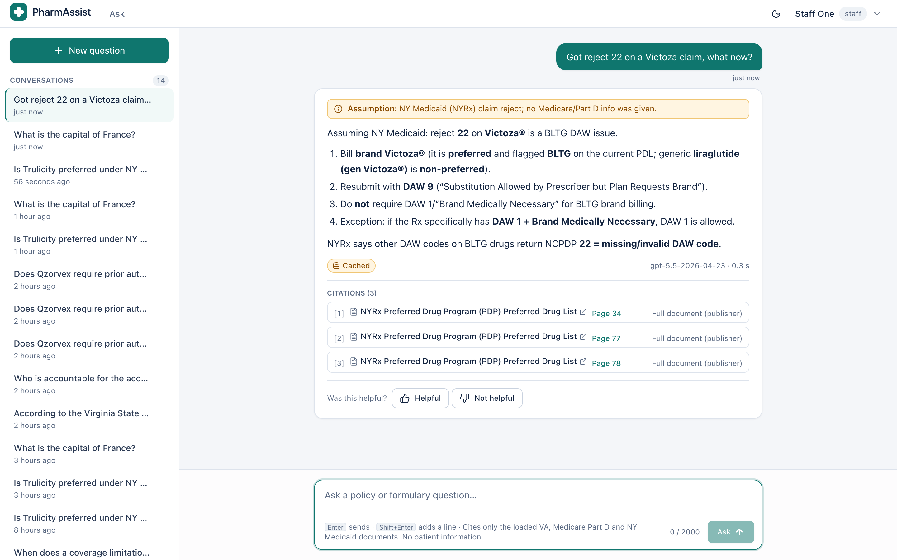
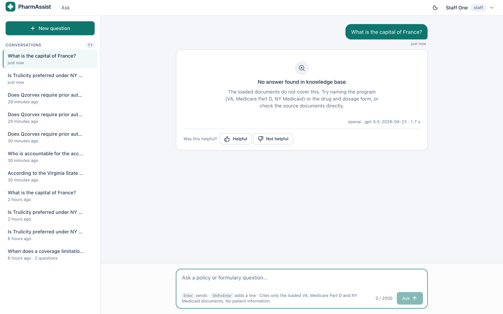
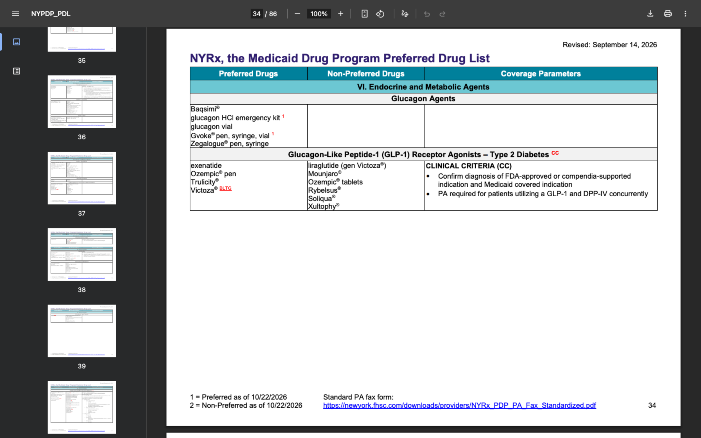
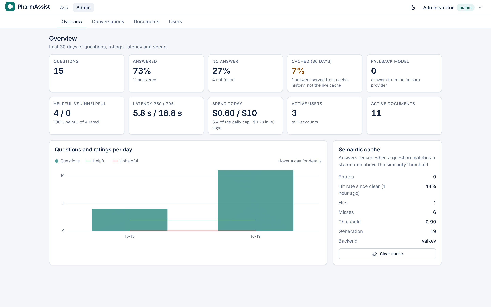
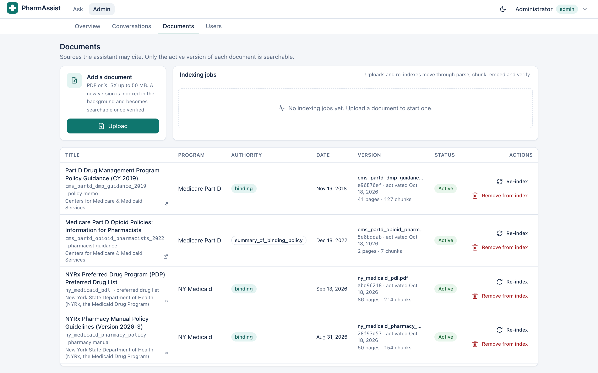

# PharmAssist

**A pharmacy policy assistant that answers one operational question with page-level citations, or says exactly
"No answer found in knowledge base".**

Pharmacy staff ask things like *"Is Ozempic preferred on NY Medicaid, and does it need PA?"* and today the answer
means reading a formulary, a preferred drug list and a policy manual. PharmAssist reads 11 public VA, Medicare
Part D and NY Medicaid documents for them and returns a 60–120-word answer whose every claim links to the source
page. It never answers from general model knowledge: an answer without a verified citation is replaced by the
fixed no-answer sentence.



| Golden set, 20 pharmacist questions | Production configuration |
|---|---|
| Accuracy | 0.85 (14 correct, 6 partial, **0 incorrect**) |
| Groundedness (claims supported by the cited pages) | 0.937 |
| Latency, fresh answer (limit 30 s) | 10.8 s median · 21.4 s p95 |
| Latency, cached repeat | 0.3–0.7 s, no model call |
| Cost per fresh question | $0.11 |

Source: [EVALUATION.md §3.1](writeup/EVALUATION.md); every number is copied from a run folder under [`reports/`](reports/).

## Quick links

| | |
|---|---|
| **Demo video** | https://youtu.be/L6lZ9rOHJQY (10 min 33 s walkthrough of the deployed application) · offline copy [writeup/demo/pharmassist-demo.mp4](writeup/demo/pharmassist-demo.mp4) |
| **Run it yourself** | [one Docker command](#run-it-locally), with the [everyday commands](#docker-commands) below it |
| **Hosted version** | Ran on AWS (`us-east-1`) at `pharmassist.aishwaryabhanage.com`, the deployment shown in the video. The stack is not kept running, to avoid the monthly cost; see [Hosting on AWS](#hosting-on-aws) to stand it up |
| **Design** | [writeup/DESIGN.md](writeup/DESIGN.md): decisions and tradeoffs, risks, metrics, architecture, quality |
| **Evaluation** | [writeup/EVALUATION.md](writeup/EVALUATION.md): method and every run from the first baseline to production |
| **Example answers** | [writeup/EXAMPLES.md](writeup/EXAMPLES.md): eight Q/A pairs verbatim, three weak answers explained · [five test questions (PDF)](writeup/Example_Questions_Expected_vs_Assistant_Answers.pdf) |
| **How it works and operations** | [writeup/SOLUTION.md](writeup/SOLUTION.md) |
| **Evidence** | [writeup/evidence/](writeup/evidence/README.md): production API transcript, screenshots, index of every report and trace |
| **Visual explainer** | [writeup/html/pharmassist-v2.html](writeup/html/pharmassist-v2.html) and HTML versions of each document in [writeup/html/](writeup/html/) (open in a browser from a clone) |
| **Every LLM prompt** | [docs/PROMPTS.md](docs/PROMPTS.md) |
| **Docker images** | [abhanage/pharmassist-v2-web](https://hub.docker.com/r/abhanage/pharmassist-v2-web), [abhanage/pharmassist-v2-ingest](https://hub.docker.com/r/abhanage/pharmassist-v2-ingest) |
| **AWS run-book** | [deploy/aws/v2/README.md](deploy/aws/v2/README.md) |

## What it does

- **One question in, one answer out.** No chat, no clarifying questions. If the program is not stated, the
  assistant infers it and states the assumption at the top of the answer.
- **Cited or nothing.** Every answer carries citations that open the stored source document at the cited page. A
  result that is not answered or not cited returns exactly `No answer found in knowledge base`.
- **Handles questions that plain chunk retrieval does not:** questions spanning several documents, structured
  lookups (formulary rows, NCPDP reject codes), conflicts between documents (decided by a fixed precedence rule the
  answer names), silence versus absence, and flowcharts printed as images.
- **Staff and admin roles.** Staff ask and rate answers. Admins see every conversation, upload, re-index or remove
  documents, manage users, clear the cache and watch spend against a daily cap.
- **Semantic cache.** A repeated or near-identical question (cosine ≥ 0.90) returns the stored answer and its
  citations in under a second with no model call.

| | |
|---|---|
|  |  |
| An off-corpus question gets the fixed no-answer sentence | A citation opens the stored document at the cited page |
|  |  |
| Admin overview: questions, latency, spend, cache | Admin documents: the corpus, uploads and indexing jobs |

More screenshots, each described: [writeup/evidence/README.md](writeup/evidence/README.md).

## How it works

```
Browser (React) ── /api/v1 ──▶ FastAPI (auth, /ask, conversations, feedback, admin)
                                 │  question embedding ─▶ Valkey semantic cache (cosine ≥ 0.90 ⇒ stored answer + citations)
                                 │  agent: OpenAI gpt-5.5 ─▶ Claude Sonnet on failure; tools: hybrid search, read_page, drug lookups
                                 ├─ PostgreSQL + pgvector: chunks, embeddings, full-text, documents, users, conversations, feedback, jobs
                                 └─ S3: source files, figure crops, uploads
admin upload ─▶ S3 + job row ─▶ SQS ─▶ worker (Docling, vision, chunking, embeddings) ─▶ Postgres ─▶ version activated
```

- **Agent, not a fixed pipeline.** A tool loop with at most 6 lookups and a 25 s deadline decides whether a question
  needs a formulary row, policy text or a second search (`src/pharmassist/agent/`).
- **Retrieval.** Child chunks (350 tokens) are matched and their parent sections (≤ 1,500 tokens) returned; search is
  pgvector dense plus Postgres full-text, fused with reciprocal rank fusion (`src/pharmassist/search/hybrid.py`).
  Formulary and preferred-drug-list tables are exact row lookups; flowcharts are read by a vision pass at ingestion.
- **Two model providers.** OpenAI `gpt-5.5` first, `claude-sonnet-5-5` on failure, behind one message format
  (`src/pharmassist/llm/`).
- **Citation check in code.** Each citation must point at a page the agent was actually given, or the answer is
  replaced by the no-answer sentence (`src/pharmassist/agent/verify.py`).
- **Ingestion.** An admin upload goes to S3 and a queue; a worker parses, chunks, embeds and activates the new
  document version, and the cache entries that depended on the old one are dropped (`src/pharmassist/ingest/`).

The reasoning behind each choice, with the alternatives measured and rejected, is in
[writeup/DESIGN.md](writeup/DESIGN.md).

## Run it locally

Everything runs in Docker: the app, the database, the cache, a local queue and a local S3. No Python or Node is
needed on your machine.

**You need**

- Docker Desktop, or Docker Engine 24+ with the compose plugin (`docker compose version` should print 2.24 or later).
- About 5 GB of free disk, and these ports free: 8000, 5432, 6379, 9000, 9001, 9324, 9325.
- An OpenAI API key. An Anthropic key is optional; it is only used as the fallback model.

**Start it**

```bash
git clone https://github.com/AishwaryaBhanage/PharmaAssist.git
cd PharmaAssist
cp .env.example .env
# edit .env: set OPENAI_API_KEY=sk-...   (optional: ANTHROPIC_API_KEY=...)
docker compose -f deploy/docker-compose.yml -f deploy/prebuilt.override.yml --env-file .env up
```

This pulls the public images (Intel and Apple Silicon), starts Postgres + pgvector, Valkey, a local SQS and S3,
loads the 11 documents from the checked-in build (no model spend) and creates the demo accounts. The first start
takes a few minutes, mostly image download. It is ready when the log says `ready: http://localhost:8000`.

**Or build the images from source** (slower, needs no Docker Hub images):

```bash
docker compose up --build
```

| Interface | How |
|---|---|
| Web | http://localhost:8000 — sign in as `admin@pharmassist.local` / `admin-password-1` (admin) or `staff1@pharmassist.local` / `staff-password-1` (staff). These accounts exist only in the local stack |
| Command line | `docker compose run --rm --no-deps -v "$PWD:/src:ro" -w /src -e PYTHONPATH=/app/src api python scripts/ask.py "Is Trulicity preferred under NY Medicaid?"` |

Try, in order: *"Is Trulicity preferred under NY Medicaid?"* (a cited answer), the same question again (served from
the cache), *"What is the capital of France?"* (the no-answer sentence), then as admin upload a one-page PDF under
Documents and watch it become answerable. Fresh answers use your API key, about $0.11 each; repeats are free.

### Docker commands

Run these from the repository root, in a second terminal while the stack is up.

| To do this | Run |
|---|---|
| Start in the background | add `-d` to the start command |
| See what is running | `docker compose ps` |
| Follow the app log | `docker compose logs -f api` |
| Follow the ingestion worker log | `docker compose logs -f worker` |
| Stop, keeping the data | `docker compose down` |
| Stop and delete all data (fresh start next time) | `docker compose down -v` |
| Get newer published images | `docker compose -f deploy/docker-compose.yml -f deploy/prebuilt.override.yml --env-file .env pull` |
| Start only the backing services (to run the app from source) | `docker compose up -d postgres valkey elasticmq s3 createbuckets` |
| Change the demo passwords | set `DEMO_ADMIN_PASSWORD` and `DEMO_STAFF_PASSWORD` in `.env` before the first start |

**If something goes wrong**

- *"port is already allocated"*: another program is using one of the ports above (often a local Postgres on 5432).
  Stop it, then start again.
- *You can sign in but questions fail*: check that `OPENAI_API_KEY` is set correctly in `.env`, then run
  `docker compose down` and start again.
- *Sign-in fails after changing passwords*: the accounts were created on the first start. Run
  `docker compose down -v` and start again.

Running from source, tests and evaluation commands: [writeup/SOLUTION.md](writeup/SOLUTION.md).

## Results

Golden set of 20 pharmacist questions, judged by Claude Opus 5.5 in 3 passes. The full history of every run,
including the rejected experiments, is in [EVALUATION.md §3](writeup/EVALUATION.md).

| | v1 best (local, reranker) | v1 hosted | **v2 production** |
|---|---|---|---|
| Accuracy (correct / partial / incorrect) | 0.925 (17 / 3 / 0) | 0.85 (15 / 4 / 1) | **0.85 (14 / 6 / 0)** |
| Groundedness | 0.887 | 0.878 | **0.937** |
| Unsupported claims | 2.5% | 4.3% | **2.5%** |
| Latency p50 / p95 (limit 30 s) | 10.6 s / 22.2 s | 7.2 s / 12.0 s | 10.8 s / 21.4 s |
| Cost per question | $0.064 | $0.067 | $0.110 |
| Visual set (8 flowchart and table questions) | 1.00 | 1.00 | 1.00 |

**Why v2 is in production although v1's best number is higher.** The 0.925 needed a reranker that takes 15–23 s per
search on the hosted CPUs and cannot meet the 30 s limit. Without it both score 0.85, and v2 is better grounded
with no incorrect answer ([EVALUATION.md §4.1](writeup/EVALUATION.md)).

**Production check, 2026-10-18.** Every API check passed against the deployed stack: login, cited answer, cache
hit in 0.4 s, the exact no-answer sentence, role enforcement, an upload indexed and answerable
([live_check_2026-10-18.log](writeup/evidence/live_check_2026-10-18.log)).

**Tests.** 657 Python tests (57 integration) and 28 frontend tests.

## Hosting on AWS

One CloudFormation stack, `pharmassist-v2`, in `us-east-1`. About $197/month always on, plus about $144/month if
the ingestion worker is kept warm. Bootstrap, certificate, DNS, deploy and teardown:
[deploy/aws/v2/README.md](deploy/aws/v2/README.md).

```
Internet → NLB (2 Elastic IPs) → WAF → ALB (HTTPS, sticky) → 2 × t4g.large app servers (API + UI)
                                                                  ├─ RDS PostgreSQL 16 + pgvector   (documents, chunks, embeddings, users, conversations)
                                                                  ├─ ElastiCache Valkey             (semantic answer cache)
                                                                  ├─ S3                              (source documents, figures)
                                                                  └─ SQS → Fargate worker            (uploads: parse, chunk, embed, activate)
Secrets Manager · CloudWatch logs and alarms · LangSmith tracing
```

## Repository layout

| Path | Role |
|---|---|
| `app/` | FastAPI API: auth (JWT + refresh cookie, staff/admin), `/ask`, conversations, feedback, admin |
| `frontend/` | React + TypeScript UI, served by the API |
| `src/pharmassist/agent/` | the tool-using agent: loop, tools, prompt, citation checks, telemetry |
| `src/pharmassist/search/`, `store/` | hybrid retrieval over PostgreSQL + pgvector and the store |
| `src/pharmassist/cache/` | Valkey semantic cache |
| `src/pharmassist/ingest/`, `scripts/ingest_worker.py` | upload → SQS → worker → activate |
| `src/pharmassist/llm/` | one message format over OpenAI (primary) and Anthropic (fallback) |
| `src/pharmassist/{parsers,chunkers,tables,embedders}/` | corpus preprocessing |
| `src/pharmassist/eval/`, `scripts/run_eval.py`, `evals/` | evaluation harness and the frozen question sets |
| `docs/` | the 11 source documents, their catalog ([SOURCES.md](docs/SOURCES.md)) and every prompt |
| `index/`, `storage/figures/` | the checked-in build the local stack loads (chunks, vectors, table rows, figure crops) |
| `reports/`, `traces/` | every evaluation run and the per-question traces of the milestone runs |
| `deploy/` | Dockerfiles, the local compose stack and the AWS CloudFormation stack |
| `writeup/` | design, evaluation, examples, evidence, demo and the HTML explainers |

## Tech stack

Python 3.12 · FastAPI · React + TypeScript · PostgreSQL 16 + pgvector · Valkey · SQS · S3 · Docling ·
OpenAI and Anthropic APIs · LangSmith · DeepEval · Docker · AWS (CloudFormation, EC2, ALB/NLB, WAF, RDS,
ElastiCache, ECS Fargate)

## Corpus

Eleven public documents on two themes, diabetes management and opioid stewardship: VA/DoD clinical practice
guidelines, VA PBM guidance, the VA National Formulary, CMS Medicare Part D opioid policy, and the NY Medicaid
(NYRx) preferred drug list and pharmacy manual. Sources, dates and preprocessing notes:
[docs/SOURCES.md](docs/SOURCES.md).

PharmAssist is a demonstration project. It is not a substitute for the source documents or for professional
judgment, and it takes no patient information.
